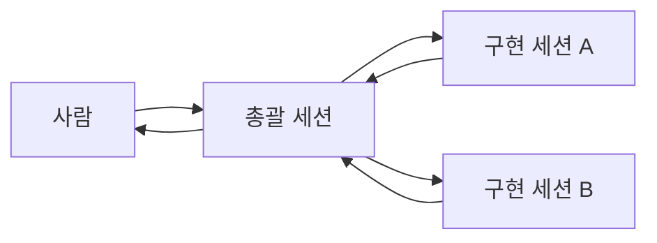

# claude-code-workflow

**여러 Claude Code 세션을 한 팀처럼 운영하는 방법의 원칙과 구조.**
세션을 나누는 이유는 일을 나누려는 게 아니라 같은 사실을 독립적으로 두 번 확인하려는 것이다.
이 저장소는 그 철학과 원칙, 대표 사고 유형, 그리고 바로 가져다 쓸 수 있는 스킬·문서 규칙 예시를 담는다.

*English, in one line: principles and structure for running several Claude Code sessions as a team
(cross-verification over report-gathering), plus generalized commit/PR skill templates.*

## 이 저장소에 있는 것

| 경로 | 내용 | 라이선스 |
|---|---|---|
| [`docs/philosophy.md`](docs/philosophy.md) | 철학과 구조: 총괄·구현·리뷰 세션의 역할, 사람이 결정하는 지점 | CC BY-NC 4.0 |
| [`docs/principles.md`](docs/principles.md) | 운영 원칙 일곱 | CC BY-NC 4.0 |
| [`docs/incident-patterns.md`](docs/incident-patterns.md) | 대표 사고 유형 둘 (원인과 교훈) | CC BY-NC 4.0 |
| [`examples/docs-rules/`](examples/docs-rules/) | AI와 사람이 함께 쓰는 문서 저장소의 규칙 예시 | CC BY-NC 4.0 |
| [`examples/skills/commit/`](examples/skills/commit/SKILL.md) | 커밋 컨벤션 스킬 템플릿 (티켓 접두사, AI 공동저자 금지) | MIT |
| [`examples/skills/pr/`](examples/skills/pr/SKILL.md) | PR 스킬 템플릿 (CLAUDE.md 정합성 점검, 인라인 리뷰, 문제 있을 때만 멈춤) | MIT |

## 이 저장소에 없는 것

단계별 운영 절차, 전체 사고 사례와 상세 분석, 세션 재연결의 구체적 절차, 프롬프트 원문,
자동화 스크립트는 담지 않았다. 여기는 원칙과 구조에서 멈춘다.

## 핵심 한 장



- 총괄 세션은 보고를 받아 적지 않고 **다시 확인한다**
- 막힌 권한은 **다른 세션으로 우회하지 않고** 사람이 그 세션에서 승인한다
- 한 저장소는 **한 세션만 쓴다** (스테이징도 쓰기다)

## 스킬 예시 설치

스킬은 Claude Code 의 스킬 디렉터리에 폴더째 복사하면 된다.

```bash
# 개인 전역 스킬로 쓰는 경우
mkdir -p ~/.claude/skills
cp -r examples/skills/commit ~/.claude/skills/commit
cp -r examples/skills/pr     ~/.claude/skills/pr
```

복사한 뒤 각 `SKILL.md` 의 안내(`This is a template`)를 따라 티켓 접두사, 메시지 언어,
라벨 이름을 팀 규칙에 맞게 고친다.

## 라이선스

파일마다 적용 범위가 다르다.

- **코드와 스킬 예시** (`examples/skills/`): [MIT](LICENSE)
- **문서** (`docs/` 와 `examples/docs-rules/`): [CC BY-NC 4.0](LICENSE-DOCS.md) —
  출처를 밝히면 복사·변형할 수 있지만 **상업적 이용은 허용하지 않는다**

## 연락처

`mobile.dev@kakao.com`
