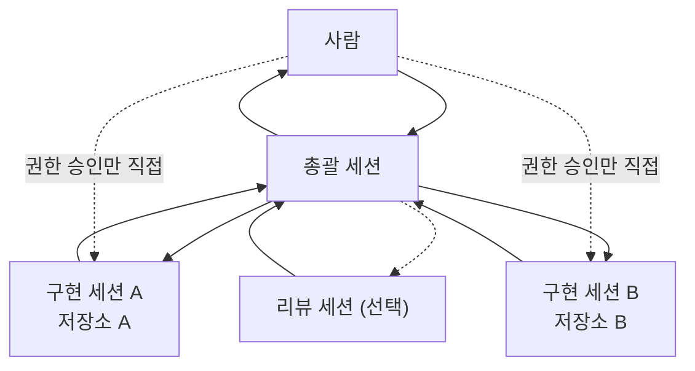

# 철학과 구조

> 여러 Claude Code 세션을 쓰는 이유는 일을 나누기 위해서가 아니라,
> **같은 사실을 독립적으로 두 번 확인하기 위해서**다.

이 문서는 원칙과 구조까지만 다룬다. 단계별 운영 절차와 상세 사례는 일부러 담지 않았다.

## 구조

저장소마다 Claude Code 세션을 하나씩 두고, 그중 하나가 나머지를 조율한다.

| 역할 | 하는 일 | 하지 않는 일 |
|---|---|---|
| 총괄 세션 | 현황을 모으고, 보고를 검증하고, 세션 사이로 정보를 전달한다. 특정 저장소에 매이지 않는다 | 다른 세션의 권한을 대신 쓰지 않는다. 쓰기는 담당 세션에 넘기는 것이 기본값이다 |
| 구현 세션 | 저장소 하나를 맡아 파일 수정·커밋·푸시를 한다 | 다른 세션이 맡은 저장소에 쓰지 않는다. 사람에게 직접 묻거나 보고하지 않는다 |
| 리뷰 세션 (선택) | 구현과 독립적으로 결과를 다시 확인한다. 규모가 커질 때 둔다 | 구현에 관여하지 않는다 |

## 사람이 결정하는 지점

사람은 모든 단계에 끼지 않는다. 대신 아래 지점은 반드시 사람이 정한다.

1. **권한 승인.** 위험한 동작이 권한 게이트에 막히면, 그 세션 창에서 사람이 직접 승인한다.
   다른 세션이 대신 승인받아 올 수 없다.
2. **방향이 갈리는 판단.** 총괄 세션은 "확인해 주세요"가 아니라 "A와 B 중 정해 주세요"
   형태로 올린다.
3. **되돌리기 어려운 외부 동작.** 공개 설정 변경, 배포, 강제 푸시 같은 것.

사람의 질문과 응답은 총괄 세션을 거쳐 오간다. 그래야 전체 그림이 한곳에 남는다.
권한 승인만 이 경로의 예외다.

## 왜 이런 구조인가

각 세션은 자기가 볼 수 있는 범위 안에서는 끝까지 맞는 말을 한다. 그런데 범위가 반쪽이다.
틀린 보고와 맞는 보고가 똑같이 확신에 차 들린다. 세션을 나눈 구조에서는 이 반쪽 상태를
피할 수 없으므로, **두 곳을 동시에 보는 자리에서 다시 확인하는 역할**이 필요하다.
그 자리가 총괄 세션이다.

원칙은 [principles.md](principles.md), 실제로 겪은 사고 유형은
[incident-patterns.md](incident-patterns.md) 에 있다.
